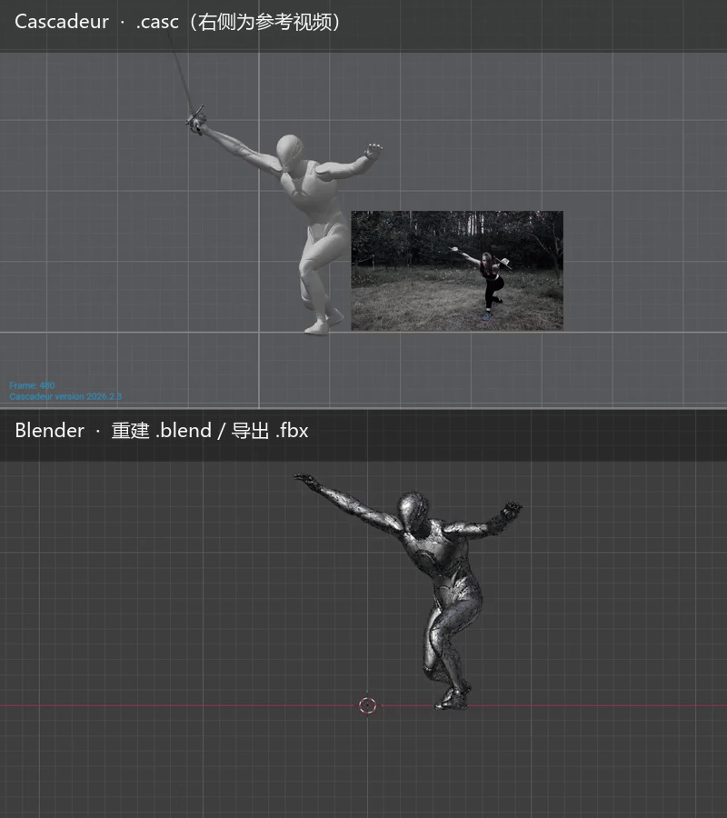

# @dsh-external/dsh-cascadeur-plugin

把 **Cascadeur 的 `.casc` 动画**搬进 **Blender / UE5**。

> 原理：通过 Cascadeur 内置的 **MCP 脚本服务器**（`127.0.0.1:8765`）读取每个关节的
> `Global Matrix`，在 Blender 里用**原版 FBX** 重建姿势，再导出 FBX。
> 不修改、不破解 Cascadeur 的任何授权机制。
>
> **精度：逐顶点误差 0.000 cm**（与 Cascadeur 自己的 `calc_skinned_mesh` 对比）。
> 这个数字不是口头保证：`verify/verify_rebuild.py` 会把它变成可执行断言（见 §验证）。

**English tl;dr** — A DSH plugin that converts Cascadeur `.casc` animations to
Blender / UE5 FBX by reading per-joint `Global Matrix` through Cascadeur's MCP
script server and rebuilding the pose on the original FBX (0.000 cm vertex
error, asserted by `verify/verify_rebuild.py`). Ships error-driven keyframe
reduction (angle + position thresholds, Bezier `AUTO_CLAMPED`), Mocap single-frame
glitch repair, and unit tests (`npm test`, `python tests/*.py`).

<p align="center">
  
</p>

<p align="center">
  <sub>左：Cascadeur 播放 <code>.casc</code>（小窗是驱动它的参考视频）　·　右：Blender 里重建后的 <code>.blend</code> / 导出的 <code>.fbx</code></sub><br>
  <sub>同一段 612 帧击剑 Mocap，逐帧同步。完整 30 fps 版：<a href="docs/demo.mp4">docs/demo.mp4</a></sub>
</p>

---

## 一、前置条件

| 项 | 要求 |
|---|---|
| Cascadeur | 任意版本（含免费版）；需要开脚本服务器（可自动化，见下） |
| Blender | 5.x（Python 需带 `zstandard`；5.4 已自带） |
| 原版模型 FBX | 当初导入 Cascadeur 用的那个 FBX（**不要用改过的**） |
| DSH | 0.1.7+ |

### 开 Cascadeur 脚本服务器

**方式 A（手动，最快）**

Cascadeur 菜单栏 → **Scripts** → **MCP** → **Start script server**

**方式 B（自动，一次配置永久生效）**

把 [`cascadeur_autostart/autostart.py`](cascadeur_autostart/) 复制到
`<Cascadeur安装目录>\resources\scripts\python\scripts\mcp\`，
之后每次启动 Cascadeur 都会自动开 8765（约 60 秒后就绪）。

详见 [cascadeur_autostart/README.md](cascadeur_autostart/README.md)。

> 没开的话工具会明确提示你怎么开。

---

## 二、工具

| 工具 | 用途 |
|---|---|
| `casc_status` | 环境自检：Cascadeur 是否可达 / Blender 路径 / 当前设置 |
| `casc_inspect` | 只读解析 `.casc`：角色、骨骼、帧范围、LOD、分层。**不需要开 Cascadeur** |
| `casc_dump` | 只导出动画数据（Global Matrix → JSON） |
| `casc2blend` | **一条龙**：读 → 重建 → `.blend`（可开启关键帧简化） |
| `casc2fbx` | **一条龙**：读 → 重建 → `.fbx`（可直接进 UE5） |
| `casc_verify` | 验证：骨骼位置 vs Cascadeur 数据（正常 < 0.01 cm） |
| `casc_config` | 读写默认设置（持久化，后续导出默认用它） |

---

## 三、典型用法

### 1. 先配置一次（之后一直生效）

```
casc_config({ set: {
  modelFbx: "D:\\path\\to\\your_original_model.fbx",
  outDir:   "D:\\path\\to\\output",
  lod:      "0"
}})
```

> `modelFbx` 必须是**当初导入 Cascadeur 用的那个原始 FBX**（不要用后来改过的）。
> `outDir` 留空则默认输出到 `<casc 所在目录>/casc_out`。

设置存在 `~/.dsh/cascadeur-settings.json`，**不改变就一直按它来**。

### 2. 看一眼 .casc 里有什么

```
casc_inspect({ casc_path: "D:\\path\\to\\scene.casc" })
```

返回：角色列表（含顶点数、蒙皮骨骼数）、关节数、帧范围、FPS、动画分层。

### 3. 一条龙导出

```
casc2fbx({ casc_path: "D:\\path\\to\\scene.casc" })
```

返回：帧数、关节数、LOD、`rest_err_cm`（应 ~0.0001）、
`bone_pos_err_cm`（应 ~0.0001）、FBX 路径与大小。

**开启关键帧简化**（推荐用于 Mocap 结果）：

```
casc2fbx({
  casc_path: "D:\\path\\to\\scene.casc",
  reduce_keys: true,     // 只写误差驱动选出的关键帧 + Bezier(AUTO_CLAMPED)
  key_angle: 2.0,        // 允许的最大平均角度误差（度）
  key_pos: 2.0,          // 允许的最大平均位置误差（厘米）
  min_gap: 1,            // 关键帧最小间隔
  despike: true          // 先修掉 Mocap 的单帧跳变
})
```

返回里会多出：

- `despike`：`fixed_frames`（被修复的跳变帧号）/ `rounds` / `converged`
- `reduce`：`dense` / `keys` / `ratio_pct` / `key_angle_deg` / `key_pos_cm` /
  `min_gap` / `violations`（**真实**超标帧数）/ `mean_angle_err` /
  `max_angle_err` / `mean_pos_err_cm` / `max_pos_err_cm` / `bezier_fcurves`
- `gm`：`cached`（是否复用了 GM 缓存）/ `path`
- `matched_bones` / `missing_bones` / `unmatched_fbx_bones`（骨骼名对不上时会显式报告）

> `violations = 0` 才代表"所有帧都满足阈值"。

### 4. 验证

```
casc_verify({ casc_path: "D:\\...\\scene.casc" })
```

它会断言 `rest_err_cm` 与 `bone_pos_err_max_cm` ≤ 0.01 cm，并检查骨骼名是否全部匹配
（缺骨时 `ok=false`）。同样的断言也能独立跑：

```bash
blender -b --factory-startup --python verify/verify_rebuild.py -- \
  --casc scene.casc --gm scene_gm.json --model-fbx Model.fbx --tolerance-cm 0.01
```

输出 markdown 表格 + 非 0 退出码，可直接进 CI。

---

## 四、设置项

| 键 | 说明 | 默认 |
|---|---|---|
| `blenderExe` | Blender 路径 | 自动探测（复用 dsh-blender-plugin 的配置） |
| `modelFbx` | 原版模型 FBX | **空**（必须先配置） |
| `lod` | 网格 LOD：`0` / `all` / `0,2` | `0` |
| `outDir` | 默认输出目录 | `<casc 同目录>/casc_out` |
| `frames` | 帧范围：`auto` / `0-10` | `auto`（用场景时间轴范围） |
| `reduceKeys` | 默认是否开启关键帧简化 | `false` |
| `keyAngleDeg` | 允许的最大平均角度误差（度） | `2.0` |
| `keyPosCm` | 允许的最大平均位置误差（厘米） | `2.0` |
| `keyMinGap` | 两个关键帧的最小间隔（1 = 允许相邻帧） | `1` |
| `despike` | 自动修复 Mocap 单帧跳变 | `true` |
| `fps` | 导出帧率（Mocap 视频通常是 25） | `30` |

---

## 五、核心公式（不要改）

```python
B4 = [[1,0,0,0],[0,0,-1,0],[0,1,0,0],[0,0,0,1]]   # Y-up → Z-up

W_rest[joint] = W_rest[parent] @ (T(pos) @ Euler(rot,'ZYX').to_matrix())
A(t) = B4 @ M_global(t)          # ⚠️ 只左乘！@ B4.T 会多转 90°，整模扭曲
D(t) = A(t) @ inv(W_rest[joint])
pose_bone.matrix = D(t) @ bone.matrix_local
```

> **踩过的坑**：`B4 @ M @ B4.T`（相似变换）会给每根骨加 90° roll，
> 表现是"每个关节都在扭"，但所有位置检查都通过（位置永远是对的）——
> 这个 bug 曾让整个项目卡了十几个小时。诊断方法：
>
> ```
> rest(stastics) ↔ Blender bind  = ~0°   ← 正常
> GM(绑定帧)     ↔ Blender bind  = 90°   ← 说明 B4 用错了
> ```

---

## 六、关键帧简化（Mocap 结果必备）

Cascadeur 的 Video-mocap 写的是**逐帧关键帧**（示例：612 帧），带有人体估计的抖动。
直接用手感很差、也难编辑。插件内置了**误差驱动**的关键帧简化：

```
从 [首帧, 末帧] 开始
→ 每帧算"用相邻关键帧插值后"的误差（角度 + 位置分开算）
→ 挑归一化违约度最大的帧加入关键帧
→ 重复，直到所有帧 max(角度/阈值, 位置/阈值) ≤ 1
```

比"只看速度"稳：**慢速但有关节的段落（缓慢收剑）不会被误删**。

### 实测（612 帧击剑 Mocap，先修复 5 帧跳变）

| 角度阈值 | 位置阈值 | 关键帧 | 占比 | 实测最大误差 | 超标 |
|---|---|---|---|---|---|
| 1.0° | 0.5 cm | 355 | 58% | 0.97° / 0.49 cm | 0 |
| 1.5° | 1.0 cm | 257 | 42% | 1.47° / 0.99 cm | 0 |
| **2.0°** | **2.0 cm** | **184** | **30%** | **1.97° / 1.97 cm** | **0** |
| 3.0° | 3.0 cm | 142 | 23% | 2.96° / 2.78 cm | 0 |
| 5.0° | 5.0 cm | 100 | 16% | 4.88° / 4.98 cm | 0 |

（`min_gap=1`；`min_gap` 调大能进一步减少帧数，但会牺牲精度——它是硬约束。）

### Mocap 跳变修复

Mocap 偶尔会有**单帧追踪失败**：该帧姿势瞬间跳几十厘米再回来，
不修的话 FBX 里会看到明显的抽搐。

```
detect_spikes: 逐帧位移 vs 局部滚动中位数，比值 > 4 且持续 ≤ 8 个帧间 → 判为跳变
repair_spikes: 用前后帧插值替换，迭代至收敛
```

上述 612 帧样例里检出并修复了 `257, 258, 259, 597, 598` 五帧
（修复前最大角度误差 27.7°，修复后 1.97°）。修复帧号写在回执的
`despike.fixed_frames` 里，不会偷偷改。

开启方式：

```
casc2fbx({ casc_path: "...", reduce_keys: true, key_angle: 2.0, key_pos: 2.0, despike: true })
```

或写进默认设置：`casc_config({set:{reduceKeys:true, keyAngleDeg:2.0, keyPosCm:2.0}})`。

> `.blend` 里是稀疏的 Bezier 关键帧（可手改）；
> `.fbx` 会按帧烘焙（引擎友好），但烘焙结果是**沿 Bezier 曲线**的，所以依然平滑。

---

## 七、把视频喂给 Cascadeur 的 Mocap（踩坑记录）

### 坑 1：视频时间基导致"只有第一帧正常"

QuickTime 视频的 `time_base` 常常是 `1/12800`，25fps 时每帧 = 512 个时间单位。
Cascadeur 抽帧时按**时间码**命名（`000000.jpg, 000512.jpg, 001024.jpg ...`），
但读取时按**帧序号**找（`000001.jpg, 000002.jpg ...`）→ 只有第 0 帧对得上。

**修复**：导入前重编码，把时间基改成 fps：

```bash
ffmpeg -i 原视频.mp4 -c:v libx264 -crf 16 -r 25 -video_track_timescale 25 -an 修复后.mp4
```

### 坑 2：`.casc` 里网格资产的两种存储格式

| 格式 | 字段 | 说明 |
|---|---|---|
| 旧 | `mesh`（base64 二进制 blob） | `[ver][count][16B/顶点][索引]` |
| 新 | `vertices` / `normals` / `texture_coords` / `triangles_vertex_indices` | 明文数组 |

插件两种都支持；视频对象（没有几何数据）会被自动跳过。

### 坑 3：Mocap 是本地 CPU 推理，吃内存

模型 787 MB（`resources\mocap.pt`），首次使用需下载；
700 帧约 23 分钟（i5-10500H，6 核），峰值内存 9 GB+，可能触发
Cascadeur 的 6 GB 限制并**清空撤销历史**。长片建议分段处理。

---

## 八、安装 / 卸载

安装（把包加入 DSH profile）：

```powershell
# 1. profile 的 package.json 里加依赖 + bundle（脚本会自动备份）
# 2. node_modules 里建 junction 指向本目录
# 3. 重启 DSH
```

见 `install.ps1` / `uninstall.ps1`。

---

## 九、验证与测试

```bash
# Node 侧纯逻辑（28 项断言，不需要 DSH / Blender）
node tests/test_core.mjs          # 或 npm test

# 关键帧简化（12 项；--bench 可跑真实 612 帧数据）
python tests/test_keyreduce.py

# .casc 解析（25 项；需要 numpy + zstandard，或用 Blender 自带 Python）
python tests/test_casc_core.py
```

精度验收（需要真实的 `.casc` + 原版 FBX，不进 CI）：

```bash
blender -b --factory-startup --python verify/verify_rebuild.py -- \
  --casc scene.casc --gm scene_gm.json --model-fbx Model.fbx --tolerance-cm 0.01
```

CI：`.github/workflows/ci.yml`（Windows runner）跑上面三套测试 + 全脚本 `ast.parse`。

> 改代码前请先读 [`AGENTS.md`](AGENTS.md) —— 里面把「会咬人」的约定按
> 「症状 → 代码位置」列了一遍（B4 只左乘、骨骼名匹配、帧范围语义、
> keyreduce 单位不能混、Mocap 跳变、BOM 禁令等）。

---

## 十、限制

- **不**跨机器：读的是本机 Cascadeur 的实时数据
- 一个 `.casc` 里多个角色时，当前导出所有蒙皮网格（`lod` 只影响带 LOD 后缀的网格，
  道具网格始终保留；`MeshObject(N)` 且 ≤4 顶点的参考视频平面会被自动跳过）
- 动画节奏按 30fps 假设（Cascadeur 默认）；非 30fps 场景会从 `scene_settings.json` 读取
- 不做 IK 重解算：直接使用 Cascadeur 求值后的 `Global Matrix`（这就是精确的原因）
- `keyreduce` 的 `min_gap` 是硬约束：设得过大会让阈值承诺失效（回执里 `violations` 会如实报告）
